# HB+ Aegis

A secure internal portal for HB+ ([hbplus.fit](https://hbplus.fit)) built with Expo, React Native, and React Native for Web with domain-restricted Google OAuth 2.0 authentication and Cloud Firestore role-based access control.

### 🌐 Live Deployment
- **Production URL**: [https://shriprakash980.github.io/Cross-Platform-Application/](https://shriprakash980.github.io/Cross-Platform-Application/)
- **Repository**: [https://github.com/shriprakash980/Cross-Platform-Application](https://github.com/shriprakash980/Cross-Platform-Application)

---

## A. Setup Instructions

### 1. Prerequisites
- **Node.js**: v18 or higher (tested on Node v24)
- **npm**: v9 or higher

### 2. Installation
Clone the repository and install all dependencies:
```bash
git clone <repository-url>
cd "Cross-platform application"
npm install
```

### 3. Environment Configuration
Create a `.env` file in the root directory by copying `.env.example`:
```bash
cp .env.example .env
```
Populate the file with your Firebase and domain configuration:
```env
# Domain restriction policy
EXPO_PUBLIC_ALLOWED_DOMAIN=hbplus.fit

# Firebase Web App Configuration (Firebase Console -> Project Settings)
EXPO_PUBLIC_FIREBASE_API_KEY=your_api_key_here
EXPO_PUBLIC_FIREBASE_AUTH_DOMAIN=your_project.firebaseapp.com
EXPO_PUBLIC_FIREBASE_PROJECT_ID=your_project_id
EXPO_PUBLIC_FIREBASE_STORAGE_BUCKET=your_project.appspot.com
EXPO_PUBLIC_FIREBASE_MESSAGING_SENDER_ID=your_sender_id
EXPO_PUBLIC_FIREBASE_APP_ID=your_app_id

# Google OAuth 2.0 Client IDs (For native mobile authentication)
EXPO_PUBLIC_GOOGLE_WEB_CLIENT_ID=your_web_client_id.apps.googleusercontent.com
EXPO_PUBLIC_GOOGLE_IOS_CLIENT_ID=your_ios_client_id.apps.googleusercontent.com
EXPO_PUBLIC_GOOGLE_ANDROID_CLIENT_ID=your_android_client_id.apps.googleusercontent.com
```

### 4. Firebase Project Setup
1. Create a project in the [Firebase Console](https://console.firebase.google.com/).
2. Enable **Google Sign-In** under **Authentication** -> **Sign-in method**.
3. Under **Authentication** -> **Settings** -> **Authorized domains**, add:
   - `localhost`
   - Your Netlify production domain (e.g., `hbplus-aegis.netlify.app`).
4. Enable **Cloud Firestore** and deploy the provided rules (`firestore.rules`):
   ```bash
   firebase deploy --only firestore:rules
   ```
   *(Or copy `firestore.rules` directly into the Firestore Rules editor in the console).*

### 5. Running the Application
- **Web**:
  ```bash
  npm run web
  # Or: npx expo start --web
  ```
  Accessible at `http://localhost:8081`.
- **Android**:
  ```bash
  npm run android
  ```
- **iOS**:
  ```bash
  npm run ios
  ```
- **Unit Tests**:
  ```bash
  npm test
  ```
- **Typecheck**:
  ```bash
  npm run typecheck
  ```
- **Production Build (Netlify Static Export)**:
  ```bash
  npm run build:web
  ```

### 6. Admin User Bootstrap
New accounts automatically receive the `User` role. To designate the initial administrator:
1. Log in once with your official `@hbplus.fit` Google account.
2. In the [Firebase Console](https://console.firebase.google.com/), open **Cloud Firestore** -> `users` collection.
3. Open your document (`uid`) and change the `role` field value from `"user"` to `"admin"`.
4. Refresh the app to access the Admin Panel and user management tools.

---

## B. Authentication Flow

The application implements a defense-in-depth authentication lifecycle across Web and Mobile:

```mermaid
sequenceDiagram
    autonumber
    actor User as HB+ Employee
    participant Client as Aegis App (Web/Native)
    participant Google as Google OAuth 2.0
    participant FBAuth as Firebase Auth
    participant Rules as Firestore Security Rules
    participant DB as Cloud Firestore (users/{uid})

    User->>Client: Click "Continue with Google"
    Note over Client,Google: Pass 'hd: hbplus.fit' as UX hint ONLY
    Client->>Google: Open Google Sign-In Popup / AuthSession
    Google-->>User: Present Google Workspace account selection
    User->>Google: Authenticate with Google account
    Google-->>FBAuth: Issue ID token with email & email_verified
    FBAuth-->>Client: Return UserCredential

    rect rgb(20, 24, 38)
    Note over Client: Step 1: Strict Client-Side Domain & Verification Check
    Client->>Client: validateUserDomain(email, email_verified)
    alt Email is NOT @hbplus.fit OR email_verified is not true
        Client->>FBAuth: Immediately signOut() and purge local Zustand store
        Client->>Client: Trigger card shake animation
        Client-->>User: Show "Access restricted. Please login using your official domain email."
    else Email matches @hbplus.fit AND email_verified is true
        Client->>Rules: Query / Write users/{uid}
        Note over Rules: Step 2: Cryptographic Server-Side Rule Validation
        Rules->>Rules: Verify request.auth.token.email.matches('.*@hbplus\\.fit$')
        Rules->>Rules: Verify request.auth.token.email_verified == true
        Rules-->>DB: Allow operation
        DB-->>Client: Return user profile (role: admin | user)
        Client->>Client: Store session in Zustand
        Client-->>User: Redirect to /dashboard
    end
    end
```



### Flow Details:
1. **Platform-Split Auth Provider**:
   - **Web**: Uses Firebase `signInWithPopup(auth, GoogleAuthProvider)` with the `hd` parameter passed as an interface hint.
   - **Native**: Uses `expo-auth-session` to retrieve the Google ID token and authenticates using `signInWithCredential`.
2. **Session Persistence**:
   - State is managed via **Zustand** (`src/store/authStore.ts`).
   - Token sessions restore seamlessly on page refresh using Firebase Auth listeners (`onAuthStateChanged`), with native persistence handled by `@react-native-async-storage/async-storage`.
3. **Route Protection**:
   - `app/_layout.tsx` monitors session state and prevents content flashing by showing a loader during session restore.
   - Direct navigation to `/dashboard` or `/admin` without authentication redirects to `/login`.
   - Authenticated users attempting to visit `/login` are automatically routed to `/dashboard`.

---

## C. How Domain Restriction Works

Domain restriction is enforced at both the client interface and the database engine level.

### 1. Client-Side Domain Validation (`src/utils/domain.ts`)
The validation function enforces the following checks:
- **Email Verification**: `email_verified` must be strictly `true`.
- **Exact Domain Extraction**: The domain is extracted strictly after the **last** `@` character to eliminate lookalike domain attacks:
  ```ts
  const atIndex = email.lastIndexOf('@');
  const domainPart = email.slice(atIndex + 1).toLowerCase();
  const isValid = domainPart === ALLOWED_DOMAIN.toLowerCase();
  ```
- **Attack Prevention**:
  - `user@evilhbplus.fit` &rarr; Extracted domain `evilhbplus.fit` &ne; `hbplus.fit` &rarr; **Rejected**
  - `user@hbplus.fit.evil.com` &rarr; Extracted domain `hbplus.fit.evil.com` &ne; `hbplus.fit` &rarr; **Rejected**
  - `user@gmail.com` &rarr; Extracted domain `gmail.com` &ne; `hbplus.fit` &rarr; **Rejected**
  - `unverified@hbplus.fit` (`email_verified: false`) &rarr; **Rejected**
  - `USER@HBPLUS.FIT` &rarr; Extracted domain `hbplus.fit` == `hbplus.fit` &rarr; **Allowed**
- **Immediate Rejection Handling**:
  If validation fails, the client immediately calls `signOut()`, purges all local state, triggers a card shake animation, and displays the exact required error message:
  > `"Access restricted. Please login using your official domain email."`

### 2. Server-Side Security Enforcement (`firestore.rules`)
Client-side checks are designed for instant user feedback. The cryptographic source of truth is enforced by **Cloud Firestore Security Rules**:

```cel
rules_version = '2';
service cloud.firestore {
  match /databases/{database}/documents {

    function isAuthenticated() {
      return request.auth != null;
    }

    function isEmailVerified() {
      return request.auth.token.email_verified == true;
    }

    function isAllowedDomain() {
      return request.auth.token.email.matches('.*@hbplus\\.fit$');
    }

    function isValidAegisUser() {
      return isAuthenticated() && isEmailVerified() && isAllowedDomain();
    }

    function isOwner(userId) {
      return request.auth.uid == userId;
    }

    function isAdmin() {
      return isValidAegisUser() &&
        exists(/databases/$(database)/documents/users/$(request.auth.uid)) &&
        get(/databases/$(database)/documents/users/$(request.auth.uid)).data.role == 'admin';
    }

    match /users/{userId} {
      allow get: if isValidAegisUser() && (isOwner(userId) || isAdmin());
      allow list: if isAdmin();

      allow create: if isValidAegisUser() &&
        isOwner(userId) &&
        request.resource.data.role == 'user' &&
        request.resource.data.uid == userId &&
        request.resource.data.email == request.auth.token.email;

      allow update: if isValidAegisUser() && (
        (isOwner(userId) &&
         request.resource.data.role == resource.data.role &&
         request.resource.data.createdAt == resource.data.createdAt) ||
        isAdmin()
      );

      allow delete: if isAdmin();
    }
  }
}
```

### 3. Why the `hd` Parameter Is Not Trusted
Passing `hd: 'hbplus.fit'` instructs Google's UI to pre-select or recommend the specified domain. However, Google's documentation explicitly warns that clients can modify OAuth request parameters. Therefore, `hd` is used strictly as a UX convenience, while security is guaranteed through verified ID token claims and Firestore rules.
